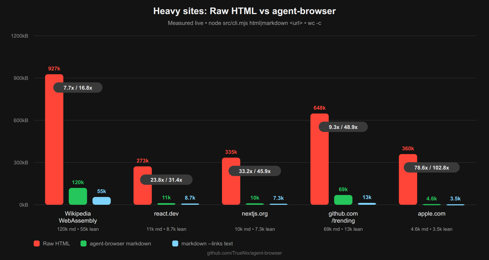
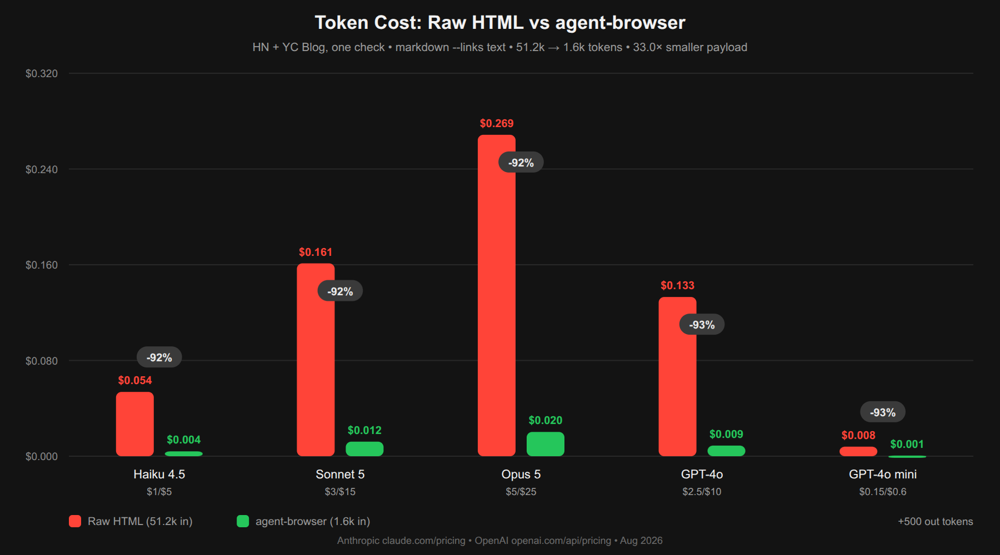

# agent-browser

A hardened local browser for AI agents. **Zero dependencies.** Drives the Chrome you already have over the DevTools Protocol, extracts token-efficient Markdown, and is not trivially flagged as automation.

| Surface | Install | Use it for |
| --- | --- | --- |
| **MCP server** | `npx -y @truenix/agent-browser mcp` | Claude Code, Cursor, Codex, any MCP client |
| **CLI** | `npx -y @truenix/agent-browser markdown <url>` | shells, scripts, CI |
| **Library** | `import { withBrowser } from '@truenix/agent-browser'` | your own Node code |
| **DSH / Cordis plugin** | composition row | native tools in a DSH harness |

```bash
npx -y @truenix/agent-browser markdown https://news.ycombinator.com
```

Everything runs locally. No account, no API key, no remote service, no quota.

## Why

Feeding an agent raw HTML wastes most of its context. Measured on real pages:

And a browser that announces itself as automation gets blocked, degraded, or served different content — which quietly corrupts whatever the agent concluded.

### Heavy-site benchmark (live, `curl` vs `markdown`)

| site | raw HTML | markdown | `--links text` | saving |
| --- | --- | --- | --- | --- |
| `en.wikipedia.org/wiki/WebAssembly` | 927 kB | **120 kB** | 55 kB | 7.7× / 16.8× |
| `react.dev` | 273 kB | **11 kB** | 8.7 kB | 23.8× / 31.4× |
| `nextjs.org` | 335 kB | **10 kB** | 7.3 kB | 33.2× / 45.9× |
| `github.com/trending` | 648 kB | **69 kB** | 13 kB | 9.3× / 48.9× |
| `apple.com` | 360 kB | **4.6 kB** | 3.5 kB | 78.6× / 102.8× |
| `news.ycombinator.com` | 35 kB | **10 kB** | 3.2 kB | 3.4× / 11.0× |

Regenerate both charts and this table's underlying measurements with
`npm run charts` — it measures live, then draws the PNGs using agent-browser
itself, so the numbers in the images cannot drift from what the code produces.

### Spending fewer tokens on the same page

URLs are a third of the output on a Wikipedia article and four fifths of it on
`github.com/trending`. When the agent is reading rather than navigating, drop them:

```bash
agent-browser markdown https://github.com/trending --links text      # 69 kB -> 13 kB
agent-browser markdown https://en.wikipedia.org/wiki/Rust --links relative
```

| mode | renders | use it when |
| --- | --- | --- |
| `inline` *(default)* | `[text](https://site/page)` | the agent will navigate next |
| `relative` | `[text](/page)` | same-site crawling; keeps targets, drops the origin |
| `text` | `text` | reading, summarising, question answering |




*Token cost per YC check (HN + YC Blog read with `--links text`, 51.2k → 1.6k tokens, +500 out) — Aug 2026 list pricing: Anthropic Haiku 4.5 $1/$5, Sonnet 5 $3/$15, Opus 5 $5/$25 • OpenAI GPT-4o $2.50/$10, GPT-4o mini $0.15/$0.60*

### Pages that render after load

Navigation waits for the `load` event, driven by CDP lifecycle events rather
than a polling loop and a fixed delay. On real pages that is 2–3× faster for
byte-identical output:

| page | `--wait load` (default) | old fixed 250 ms settle |
| --- | --- | --- |
| `example.com` | 7 ms | 258 ms |
| `github.com/trending` | 115 ms | 340 ms |
| `nextjs.org` | 160 ms | 365 ms |
| `news.ycombinator.com` | 218 ms | 466 ms |

A client-rendered app whose content arrives *after* load needs a real signal,
not a bigger guess — the old 250 ms settle missed that content too:

```bash
agent-browser markdown https://some-spa.example --wait idle
```

| mode | waits for | use it when |
| --- | --- | --- |
| `domcontentloaded` | the DOM is parsed | you only need markup that shipped in the HTML |
| `load` *(default)* | the load event | almost always |
| `idle` | the network goes quiet | the result looks like an empty shell |

## Any other harness

If your framework speaks JSON Schema, it can drive agent-browser without this
project knowing the framework exists. `agent-browser tools` prints the catalogue
in whichever shape you need:

```bash
agent-browser tools                     # MCP:       {name, description, inputSchema}
agent-browser tools --format openai     # OpenAI:    {type:"function", function:{...}}
agent-browser tools --format anthropic  # Anthropic: {name, description, input_schema}
```

Each tool then runs either way, whichever your harness can do:

```js
import { findTool, TOOLS } from '@truenix/agent-browser/tools';
import { withBrowser } from '@truenix/agent-browser';

// in-process: the harness can hold a CDP session
const tool = findTool('browser_markdown');
const text = await withBrowser({}, async (session) => {
  await session.navigate('https://example.com');
  return tool.run(session, { url: 'https://example.com', links: 'text' });
});

// out-of-process: the harness can only run a command (sandboxes, shells)
tool.cli({ url: 'https://example.com', links: 'text' });
// => ['markdown', 'https://example.com', '--links', 'text']
```

## Install

### As an MCP server

<details open>
<summary><b>Claude Code</b></summary>

```bash
claude mcp add browser -- npx -y @truenix/agent-browser mcp
```
</details>

<details>
<summary><b>Cursor / Windsurf / generic <code>mcpServers</code> JSON</b></summary>

```json
{
  "mcpServers": {
    "browser": {
      "command": "npx",
      "args": ["-y", "@truenix/agent-browser", "mcp"]
    }
  }
}
```
</details>

Tools: `browser_markdown`, `browser_text`, `browser_html`, `browser_links`, `browser_screenshot`, `browser_evaluate`, `browser_accessibility_tree`, `browser_pdf`, `browser_probe`.

Every surface exposes the same nine tools from one shared catalogue, so the CLI, the MCP server and the DSH plugin can never drift apart.

### As a library

```bash
npm install @truenix/agent-browser
```

```js
import { withBrowser } from '@truenix/agent-browser';

const md = await withBrowser({}, async (session) => {
  await session.navigate('https://example.com');
  return session.markdown();
});
```

### As a DSH / Cordis plugin

**One-liner (recommended — auto-wires when you *mean* DSH):**

```bash
npx -y @truenix/agent-browser install          # adds the bundle to ~/.dsh/profiles/web/package.json, then pnpm install (the mount ships in the package's own cordis.patch.yml layer)
# npx -y @truenix/agent-browser install --profile web --dry-run  # preview
# npx -y @truenix/agent-browser uninstall      # remove again
```

Restart `dsh` — all nine `browser_*` tools appear as native tools. No handler runs on plain `npm install`; intentional `install` is required.

**Manual (if you prefer to edit the composition yourself):**

```bash
npm i -g @truenix/agent-browser
# or inside the harness checkout: pnpm add @truenix/agent-browser
```
Requires Node ≥ 18 and a Chrome/Chromium install. Then add to the *host* composition (tools registry lives on host, not per-agent):

```yaml
# ~/.dsh/profiles/web/cordis.patch.yml  — persists for every web session
- insert:
  - id: agent-browser
    name: '@truenix/agent-browser/cordis'
    config:
      timeoutMs: 180000   # per-tool call budget; default respects AGENT_BROWSER_BIN / ENDPOINT
      # cli: 'npx -y @truenix/agent-browser'  # override only if needed
```

Short form (when the composition already wraps `insert`):

```yaml
- '@truenix/agent-browser/cordis':
    timeoutMs: 180000
```

Env overrides: `AGENT_BROWSER_BIN` (Chrome binary), `AGENT_BROWSER_ENDPOINT` (attach to long-lived browser via `--endpoint`), or `config.cli`.

## CLI

```
agent-browser <command> [options]

  markdown <url>     Extract the page as Markdown (main content by default)
  text <url>         Visible text only
  html <url>         Full serialized DOM after JavaScript runs
  links <url>        Every anchor as JSON
  screenshot <url>   PNG/JPEG   (-o file, --full)
  pdf <url>          PDF        (-o file)
  a11y <url>         Filtered accessibility tree
  eval <url> <expr>  Evaluate JS in the page
  probe              Browser, GPU and capability report
  mcp                Run as an MCP server on stdio
```

Options: `--headful`, `--no-stealth`, `--block-images`, `--gpu`/`--no-gpu`, `--width`, `--height`, `--viewport WxH`, `--main`, `--raw`, `--full`, `--endpoint <ws>`, `--timeout`, `--json`, `-o`.

`--endpoint` attaches to an already-running browser instead of launching one — useful for reusing a single long-lived browser across many calls.

## Bot detection

Run it yourself: `npm run test:bot`. Latest result:

| detector | result |
| --- | --- |
| [`bot.sannysoft.com`](https://bot.sannysoft.com/) | **31 passed, 0 failed** |
| [`bot-detector.rebrowser.net`](https://bot-detector.rebrowser.net/) | **6 green, 0 red**, `runtimeEnableLeak: clean` |
| [`deviceandbrowserinfo.com`](https://deviceandbrowserinfo.com/are_you_a_bot) | **`isBot: false`**, 0 of 22 checks flagged |

Plain headless Chrome fails four sannysoft rows (`HEADCHR_UA`, `CHR_MEMORY`, WebGL SwiftShader, old UA) and is reported as a bot.

An unreachable detector counts as **SKIP**, never as a pass, and the gate requires three reachable passes — so a day when the test sites are down cannot be mistaken for success.

### Environment matters more than patching

The identical code, measured in two places:

| | this workstation | GitHub Actions runner |
| --- | --- | --- |
| IP | residential | datacenter |
| GPU | real (NVIDIA) | none → SwiftShader |
| `bot.sannysoft.com` | 31 passed, **0 failed** | 30 passed, 1 failed (`WebGL Renderer`) |
| `bot-detector.rebrowser.net` | 6 green, **0 red** | 6 green, **0 red** |
| `deviceandbrowserinfo.com` | **`isBot: false`** | **`isBot: true`** (`hasSuspiciousWeakSignals`) |

Every CDP-level signal stays clean in both — that part is code, and the code is
right. What flips the verdict is the environment: a datacenter ASN plus software
rendering trips a weak-signal composite that no amount of fingerprint patching
addresses.

This is the honest shape of the problem. Hardening the browser removes the
*trivial* tells. Where you run it decides the rest.

### What the hardening does, and why

Every item came from a detector telling us we were wrong:

- **No `--enable-automation`.** That flag — which Puppeteer and Playwright add — is what sets `navigator.webdriver = true`. Raw CDP does not set it, so it stays `false` with nothing patched.
- **No `Runtime.enable`.** It is the loudest CDP tell and powers the classic console/`Error.stack` detector. `Runtime.evaluate` works fine without it.
- **Window and screen move together.** `--window-size` without `--ozone-override-screen-size` gives `outerWidth > screen.width`, which is physically impossible — a *stronger* signal than plain headless.
- **No default device-metrics override.** The usual 1280×720 is Playwright's default viewport and detectors flag it *by name*. Set `--viewport` only if you need it.
- **Real GPU when available**, giving a genuine `ANGLE (NVIDIA …)` renderer instead of SwiftShader.
- **UA set at launch, not only over CDP.** `Emulation.setUserAgentOverride` does not reach Web Workers, so a worker keeps reporting the headless UA while the page reports the clean one (`hasInconsistentWorkerValues`).
- **No `acceptLanguage` override.** CDP derives `navigator.languages` by splitting that header, so `"en-US,en;q=0.9"` becomes `["en-US","en;q=0.9"]` — a q-value where none can legally exist, and another page/worker mismatch. `--lang` does it correctly.
- **Client Hints derived from the binary's own version**, so `Sec-CH-UA` cannot disagree with `navigator.userAgent`.
- **Isolated browser context per session**, disposed on close — clean state per task without a second browser process.

**The recurring lesson: consistency beats coverage.** Four of those are cases where partial spoofing made detection *easier*, caught only by running real detectors.

### Why WebGL spoofing is off by default

`spoofWebgl` exists and is implemented carefully — a `Proxy` around native `getParameter`, so `Function.prototype.toString` still reports `[native code]`. **It is off, because measurement says it backfires.** From `test/webgl-spoof-experiment.mjs`:

| arm | renderer claimed | maxTexture | extensions | sannysoft | verdict |
| --- | --- | --- | --- | --- | --- |
| real GPU, no spoof | NVIDIA | 32768 | 37 | 0 failed | `isBot: false` ✅ |
| SwiftShader, honest | SwiftShader | 8192 | 35 | 1 failed | `isBot: false` ✅ |
| SwiftShader **+ spoof** | NVIDIA | **8192** | **35** | 0 failed | **`isBot: true`** ❌ |

Claiming hardware you do not have fixes one cosmetic row and **fails the composite detector**: the injected script does not reach Web Workers, so the worker still reports SwiftShader, and `MAX_TEXTURE_SIZE` stays at the software value while the renderer string claims a discrete GPU.

Honest SwiftShader passes. A convincing lie does not. Give the browser a real GPU instead — it is free.

### What this does NOT do

Fingerprint-level detection is the entire scope. It does not defeat, and does not try to:

- **TLS/JA3-JA4 and HTTP/2 fingerprinting** — decided before any JavaScript runs
- **IP reputation** — datacenter vs residential ASN, often the real blocker
- **Behavioural analysis** — mouse paths, timing, dwell

Commercial challenge products lean on those, so "passes the gate" means *not trivially flagged as automation*, never *undetectable*. Intended for your own sites, testing, accessibility work, and ordinary agent browsing.

## Memory

A Chrome stack costs roughly **450 MB**. The lever is architecture, not flags: run **one** browser and many isolated contexts rather than one browser per task. Start a browser once, then point every call at it with `--endpoint` / `AGENT_BROWSER_ENDPOINT`. `--block-images` helps for text work.

## Zero dependencies

`dependencies` is empty, including the WebSocket transport.

Node's global `WebSocket` (WHATWG) cannot send request headers, which any authenticated or proxied CDP endpoint needs, and `undici` is not importable standalone. So [`src/ws.mjs`](src/ws.mjs) implements RFC 6455 directly over `node:http(s)` — handshake, masking, continuation fragments, 64-bit lengths, ping/pong — which is everything CDP requires.

The Markdown converter walks the DOM with an **explicit stack**, keeping JS call depth at O(1) regardless of nesting, and uses native `innerText` for leaf-level inline nodes. That makes it both recursion-safe on deeply nested documents and markedly faster on large pages.

## Environment

| | |
| --- | --- |
| `AGENT_BROWSER_BIN` | path to a Chrome/Chromium binary |
| `AGENT_BROWSER_ENDPOINT` | attach to this CDP endpoint instead of launching |

## Requirements

Node ≥ 18 and a Chrome/Chromium install. No build step.

## Credits

This project's hardening is almost entirely derived from other people's published detection research — see [CREDITS.md](CREDITS.md). Particular thanks to [rebrowser-bot-detector](https://github.com/rebrowser/rebrowser-bot-detector), [bot.sannysoft.com](https://bot.sannysoft.com/), [deviceandbrowserinfo.com](https://deviceandbrowserinfo.com/), and [Camoufox](https://github.com/daijro/camoufox) for showing how this is done properly.

## License

MIT
